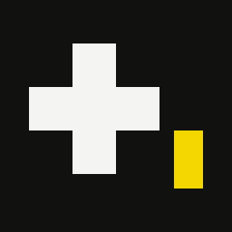
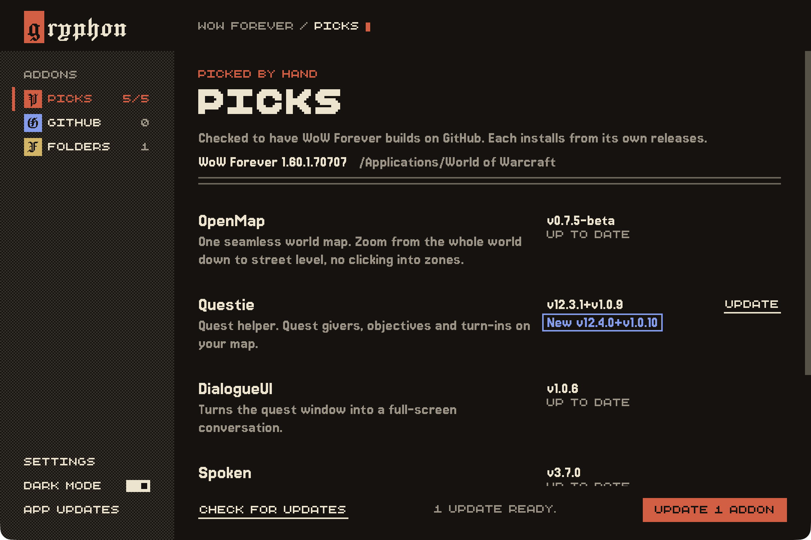

# Gryphon

Gryphon installs and updates addons for World of Warcraft: Forever. It pulls them straight from each addon's GitHub releases, so there's no CurseForge, no Overwolf, no account and no ads.

I made it for me and a few friends ahead of Forever's launch. It's small on purpose. You pick an addon, it grabs the Forever build, and it keeps it up to date after that.



There are a few more screenshots in the `screenshots` folder, including the light theme. There's more about it at **[timothyali.com/gryphon](https://www.timothyali.com/gryphon/)**.

## Download

Grab the latest build from the [Releases](../../releases/latest) page. From 0.2.0 on, Gryphon can update itself: click **App updates** at the bottom of the sidebar.

| Platform | File |
| --- | --- |
| macOS, Apple silicon and Intel | `Gryphon_<version>_mac-universal.dmg` |
| Windows, x64 | `Gryphon_<version>_x64-setup.exe` |
| Linux, x86_64 | `Gryphon_<version>_amd64.AppImage` or `Gryphon_<version>_amd64.deb` |

Every release ships a `SHA256SUMS` file. Run `shasum -a 256 <file>` and compare
the result with that file's entry in `SHA256SUMS`.

### macOS

Builds are signed with a Developer ID and notarized by Apple. Open the dmg
and drag Gryphon to Applications.

### Windows

The installer isn't signed yet, so the first time you run it Windows shows a
blue "Windows protected your PC" box. Click **More info**, then **Run anyway**.

### Linux

The AppImage needs to be executable once: `chmod +x Gryphon_*.AppImage`.
The deb installs with `sudo dpkg -i Gryphon_*.deb`.

## What it does

- It comes with a short list of addons I've checked have real Forever builds: OpenMap, Questie, DialogueUI and Spoken, plus Spoken's quest voices, and Tome, my own addon that puts tabs on the game's windows.
- It can install other addons too. Paste the addon's GitHub repo, and as long as a release has a zip built for Forever, Gryphon installs it. Nothing in your AddOns folder changes until that's been checked.
- It checks for updates and installs them when you say so.
- Before an update or a removal touches anything, the old copy of the folder goes to `Interface/.gryphon-backup`, so you can always get it back.
- Addons you installed some other way are left alone. Gryphon just lists them and tells you whether Forever will load them.
- It can change a few graphics settings the game's own menu stops short of: draw distance, grass, small objects, detail distance and sharpening. It changes them in `WTF/Config.wtf` while the game is closed, copies that file to the backup first, and can put each one back the way it was.

It finds the game in the usual place on its own. If yours lives somewhere else, you can point it at the World of Warcraft folder in Settings.

## GitHub limits

Without signing in, GitHub allows 60 update checks an hour from your network. That's plenty for a handful of addons. If you ever run into it, make a GitHub token with no scopes and paste it into Settings. Heads up: it's saved in plain text in the app's settings file.

## Running it yourself

You'll need Rust, the WebAssembly target, Trunk and the Tauri CLI:

```bash
rustup target add wasm32-unknown-unknown
```

```bash
cargo install trunk tauri-cli
```

Then start the app from `crates/app`:

```bash
cd crates/app && cargo tauri dev
```

`cargo tauri build` in the same folder makes a proper app you can drag into Applications.

If you only want to look at the interface, `trunk serve --config crates/ui/Trunk.toml --port 5190` opens it in a browser with some made-up addons to click around.

## From the terminal

The same engine works without the window:

```bash
cargo run -p gryphon-cli -- help
```

`status` shows the game and what's installed, `list` shows the built-in picks, `check` looks for updates, and `install`, `update` and `remove` do what they say, and `graphics` shows or changes the graphics settings. `install` takes a pick's name (like `openmap`) or any GitHub repo. Set `GITHUB_TOKEN` if you want the higher limit here too.

## How it's laid out

- `crates/core` does the real work: finding the game, reading `.toc` files, talking to GitHub and installing.
- `crates/app` is the desktop window, built with Tauri.
- `crates/ui` is the page inside that window, written in Leptos and built with Trunk.
- `crates/cli` is the terminal version.
- `crates/shared` holds the types the app and the page both use.

## Tome

Tome, the addon that puts one set of tabs beside your Forever windows, lives
in its own repository at [tasyusef/tome](https://github.com/tasyusef/tome).

## License

Gryphon is free software. You can share it and change it under the GNU General Public License, version 3 or any later version. The full text is in [LICENSE](LICENSE).
